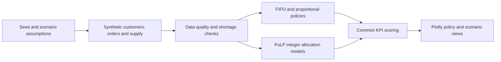
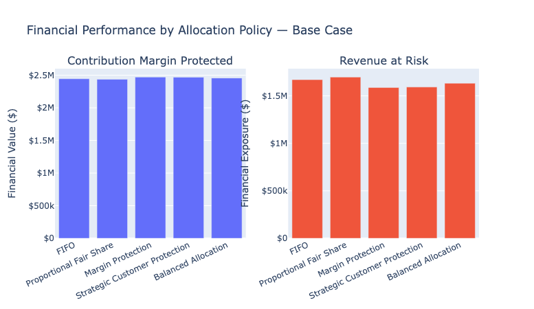
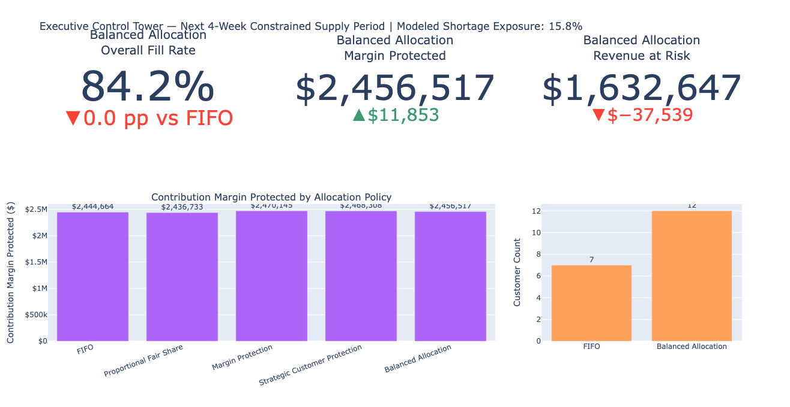
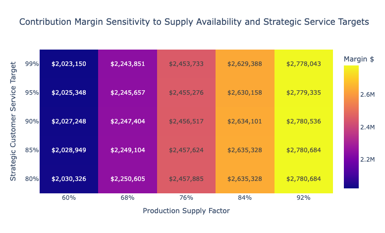

# Production Shortage Allocation and Revenue-at-Risk Optimizer

## Overview

This notebook models how a manufacturer could allocate limited supply across competing customer orders. It generates synthetic customers, products, demand and supply, then compares FIFO, proportional allocation, margin protection, strategic customer protection and a balanced allocation policy. PuLP/CBC optimization combines integer allocation policies with a continuous balanced-policy model, SKU supply limits and penalized customer-service shortfalls. Pandas calculates service and financial measures, while Plotly presents shortage, policy, scenario and sensitivity views. The implementation is a local decision-support simulation, not an ERP integration or a deployed allocation service. Its results depend on synthetic inputs, policy weights and assumptions. The cleaned copy preserves the original model and figures, makes dependency setup portable and rejects unsafe optimizer inputs before they can produce misleading recommendations.

## Business problem and objectives

When supply cannot cover confirmed orders, first-come-first-served allocation may conflict with margin and customer-service goals. This project makes those trade-offs visible, compares policies on a common dataset and explores how shortages and service targets affect outcomes. Model outputs support discussion; they do not replace contractual or operational approval.

## Technology stack

Python, NumPy, pandas, PuLP 3.3.0 with CBC, Plotly and Jupyter. Jinja2 supports styled pandas display tables. There is no SQL database, cloud service, external API or business-system connector in the supplied implementation.

## Data and assumptions

All modeling inputs are generated in the notebook from its `CONFIG` and random seed. They include customer priorities and contract flags, product economics, orders, starting inventory and planned supply. No confidential production dataset is required. Values are simulated currency/unit quantities; projections and optimization deltas are not achieved commercial benefits. The scenario and Monte Carlo sections are sensitivity illustrations; the Monte Carlo section interpolates precomputed responses rather than solving a fresh optimization for every draw.

## Architecture and workflow



## Implementation and business logic

The notebook validates input data, computes SKU shortages and scores allocated versus unfilled orders. The optimizer limits order allocation by demand and SKU supply. The shared optimizer uses integer units, while the standalone balanced/scenario implementations allow continuous quantities. Fractional allocations are planning values, not directly dispatchable discrete-unit instructions; no rounding or operational feasibility guarantee is implied. Strategic/contractual service targets use explicit shortfall variables with economic penalties, so a target is not a guaranteed service level. Balanced allocation also rewards minimum customer fill. Financial outputs include protected contribution margin, revenue/margin at risk and contract-penalty exposure.

The cleanup adds guards for missing SKU supply, duplicate order/SKU keys, non-finite or fractional unit quantities and invalid service targets. It also rejects non-optimal results before extraction. These checks prevent absent supply rows from accidentally leaving demand unconstrained. Existing scoring, scenario and visualization logic is retained.

## Dashboards and findings

The notebook produces policy comparisons, supply/demand plots, customer-service analysis, scenario comparisons, a sensitivity heatmap and an executive control-tower view. The images below are original illustrative outputs, not newly captured dashboards or evidence of actual business savings. The local execution results and exact test scope are recorded in [AUDIT.md](AUDIT.md).





A defensible analytical takeaway is that allocation-policy objectives affect margin and customer distribution even under the same physical supply limit. No universal optimal business policy is claimed; weights and service assumptions require stakeholder review.

## Project structure

```text
notebook/        shortage_allocation_revenue_risk_optimizer.ipynb
images/          five original result illustrations
requirements.txt
README.md
AUDIT.md
ATTRIBUTION.md
LICENSE          original MIT license
```

## Installation and execution

Python 3.10+ is required. Create an isolated environment from this folder:

```sh
python3 -m venv .venv
source .venv/bin/activate
python -m pip install -r requirements.txt
jupyter lab notebook/shortage_allocation_revenue_risk_optimizer.ipynb
```

On Windows, activate with `.venv\Scripts\activate`. Run all cells in order. The first solver test should print `Optimal` and a test value of 10. PuLP is pinned because the notebook uses `PULP_CBC_CMD`; do not upgrade to an incompatible major release without adapting the solver interface. If CBC is unavailable on a platform, resolve that environment issue before interpreting allocations. No `apt-get` or automatic in-notebook package upgrades are performed.

Stale saved outputs were cleared after the source fixes. The notebook remains executable and generates plots when run; original PNG examples are preserved. Plotly JSON generation was tested, while a browser-by-browser rendering review is outside the local execution check.

## Attribution and license

Copyright (c) 2026 **Aadithyan Prasanth Veenalekshmy**, retained under the supplied [MIT license](LICENSE). This cleanup does not replace original authorship with `amrut-mdsh`. See [ATTRIBUTION.md](ATTRIBUTION.md) for the separation of original work and local maintenance.

## Modeling limitations

The reported OTIF/perfect-order measures are modeled proxies, not measured delivery outcomes. The control-tower count of strategic accounts below 90% now aggregates allocated units and demand by customer and applies a 1e-6 tolerance, correcting the original order-level test. Original policy assumptions were retained rather than silently redefining the business model.

## Future improvements

Add authorized real-world input adapters, calibrated policy weights, independent scenario validation and explicit approval controls before operational use. These are proposed enhancements, not implemented features.
